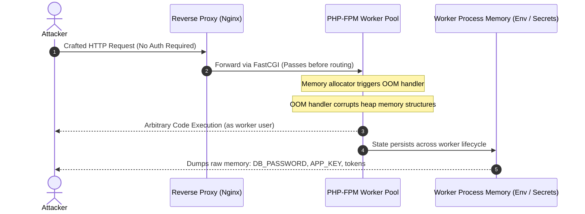
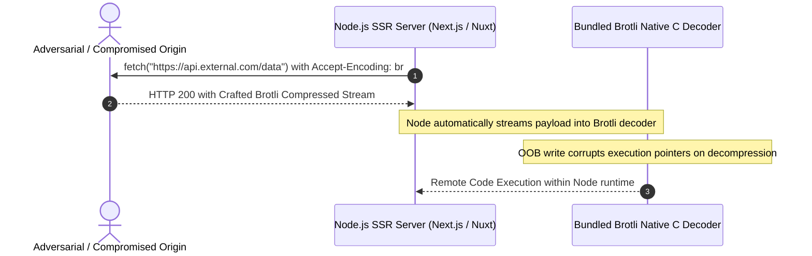

# PHP2Shell and Node2Shell: The Runtime-Level RCE You Can't Code Around

<div class="overflowbyte-threat-banner" style="position: relative; margin: 1.5rem 0; padding: 1.25rem 1.5rem; border-radius: 12px; background: linear-gradient(135deg, rgba(239, 68, 68, 0.15) 0%, rgba(15, 23, 42, 0.6) 100%); border: 1px solid rgba(239, 68, 68, 0.35); box-shadow: 0 0 30px rgba(239, 68, 68, 0.15);">
  <div style="display: flex; align-items: center; justify-content: space-between; flex-wrap: wrap; gap: 0.75rem;">
    <div style="display: flex; align-items: center; gap: 0.75rem;">
      <span style="position: relative; display: flex; height: 12px; width: 12px;">
        <span style="animation: ping 1.5s cubic-bezier(0, 0, 0.2, 1) infinite; position: absolute; display: inline-flex; height: 100%; width: 100%; border-radius: 9999px; background-color: #ef4444; opacity: 0.75;"></span>
        <span style="position: relative; display: inline-flex; border-radius: 9999px; height: 12px; width: 12px; background-color: #dc2626;"></span>
      </span>
      <span style="font-family: 'JetBrains Mono', monospace; font-size: 0.85rem; font-weight: 700; color: #fca5a5; letter-spacing: 0.08em; text-transform: uppercase;">
        CRITICAL RUNTIME ZERO-DAY · CVSS 9.2 · EXPLOITED IN THE WILD
      </span>
    </div>
    <a href="/static/php2shell-node2shell.html" target="_blank" rel="noopener noreferrer" style="display: inline-flex; align-items: center; gap: 0.4rem; padding: 0.4rem 0.9rem; font-size: 0.82rem; font-weight: 600; color: #5ce1ff; background: rgba(92, 225, 255, 0.12); border: 1px solid rgba(92, 225, 255, 0.3); border-radius: 6px; text-decoration: none;">
      <span>Open Fullscreen Experience ↗</span>
    </a>
  </div>
</div>

<style>
@keyframes ping {
  75%, 100% {
    transform: scale(2);
    opacity: 0;
  }
}
@keyframes pulseGlow {
  0%, 100% { box-shadow: 0 0 20px rgba(99, 102, 241, 0.25); border-color: rgba(99, 102, 241, 0.4); }
  50% { box-shadow: 0 0 35px rgba(92, 225, 255, 0.4); border-color: rgba(92, 225, 255, 0.6); }
}
.interactive-experience-wrapper {
  animation: pulseGlow 4s ease-in-out infinite;
}
</style>

<!-- Embedded Interactive Animated Blog Experience -->
<div class="interactive-experience-wrapper" style="margin: 2rem 0; border-radius: 14px; overflow: hidden; background: #070b16; border: 1px solid rgba(99, 102, 241, 0.35); box-shadow: 0 20px 50px rgba(0, 0, 0, 0.6);">
  <div style="display: flex; align-items: center; justify-content: space-between; padding: 0.75rem 1.25rem; background: rgba(15, 23, 42, 0.95); border-bottom: 1px solid rgba(255, 255, 255, 0.08);">
    <div style="display: flex; align-items: center; gap: 0.75rem;">
      <div style="display: flex; gap: 6px;">
        <span style="width: 10px; height: 10px; border-radius: 50%; background: #ef4444; display: inline-block;"></span>
        <span style="width: 10px; height: 10px; border-radius: 50%; background: #f59e0b; display: inline-block;"></span>
        <span style="width: 10px; height: 10px; border-radius: 50%; background: #10b981; display: inline-block;"></span>
      </div>
      <span style="font-family: 'JetBrains Mono', monospace; font-size: 0.8rem; font-weight: 600; color: #94a3b8;">
        OverflowByte Interactive Security Lab · PHP2Shell & Node2Shell Live Simulation
      </span>
    </div>
    <div style="display: flex; align-items: center; gap: 0.5rem;">
      <a href="/static/php2shell-node2shell.html" target="_blank" rel="noopener noreferrer" title="Launch full screen in a new window" style="font-family: 'JetBrains Mono', monospace; font-size: 0.75rem; color: #5ce1ff; text-decoration: none; padding: 0.25rem 0.6rem; border-radius: 4px; background: rgba(92, 225, 255, 0.08); border: 1px solid rgba(92, 225, 255, 0.2);">
        Full Window ↗
      </a>
    </div>
  </div>
  <iframe src="/static/php2shell-node2shell.html" style="width: 100%; height: 850px; border: none; display: block; background: #070b16;" title="PHP2Shell and Node2Shell Interactive Guide" loading="eager" allow="fullscreen; clipboard-write"></iframe>
</div>

> [!danger] Critical Advisory — 23 October 2026 · CVSS 9.2
> Two critical Remote Code Execution (RCE) vulnerabilities landed on the two most widely deployed web runtimes on the planet in the exact same week. 
> 
> Because both bugs reside inside the **runtime engines themselves**, your application-level code — no matter how clean, audited, or well-architected (Laravel, Express, Next.js) — buys you zero protection. The bug triggers before application logic or middleware ever executes.

---

## TL;DR & Executive Overview

| Vulnerability | CVE IDs | Root Cause | Impact | CVSS Score |
| :--- | :--- | :--- | :--- | :--- |
| **PHP2Shell** | CVE-2026-109618<br>CVE-2026-109619 | OOM handling memory corruption + Stale worker state | Unauthenticated RCE + Full Worker Memory Disclosure | **9.2 (Critical)** |
| **Node2Shell** | CVE-2026-111497 | Out-of-bounds write in bundled Brotli decoder | RCE via SSR `fetch()` / HTTP Client decompression | **Critical** |

Both vulnerabilities grant **unauthenticated remote code execution**. Both bypass:
- Web framework routers (Laravel, Symfony, WordPress)
- Authentication middleware & JWT guards
- Input validation & sanitize layers
- Application-level firewalls (WAF rules not inspecting chunked OOM patterns)

---

## The Three Core CVEs

### 1. CVE-2026-109618 — PHP2Shell: OOM Memory Corruption
- **Mechanism:** Memory corruption during out-of-memory (OOM) handling in PHP-FPM. 
- **Exploitation:** An unauthenticated attacker sends a specially crafted request (no valid credentials or existing route needed). When PHP's memory allocator encounters an induced OOM condition, the handler writes to freed memory structures, yielding arbitrary write-what-where execution.
- **Impact:** Immediate Remote Code Execution under the privilege of the `php-fpm` pool user (typically `www-data` or `nginx`).

### 2. CVE-2026-109619 — PHP2Shell: Stale Worker State & Memory Exfiltration
- **Mechanism:** Stale global state persistence across persistent PHP-FPM worker processes.
- **Exploitation:** Following an OOM event or partial memory corruption, subsequent requests dispatched to that same persistent worker inherit tainted state. Qualys confirmed that this discloses raw PHP worker process memory back to HTTP responses.
- **Data Leaked:**
  - Database passwords and connection strings (`DB_PASSWORD`)
  - Cloud storage keys (AWS S3, Cloudflare R2, GCP credentials)
  - Application secrets (Laravel `APP_KEY`, Django secret keys)
  - Active user session tokens and JWT signing keys
  - Error monitoring tokens (Sentry, Datadog tokens)

> [!warning] The Graceful Reload Trap
> Standard zero-downtime deployment pipelines typically run `systemctl reload php-fpm`. **A graceful reload keeps existing tainted workers alive until they hit `pm.max_requests`!** You **must** issue a full hard restart (`systemctl restart php8.4-fpm`) to flush poisoned worker processes.

### 3. CVE-2026-111497 — Node2Shell: Bundled Brotli Out-of-Bounds Write
- **Mechanism:** Out-of-bounds write inside Node.js's native bundled C Brotli decompression library.
- **Exploitation:** Any Node.js process using native HTTP clients (`fetch()`, `undici`, `axios`, `http.get`) automatically negotiates `Accept-Encoding: br`. When an application performing Server-Side Rendering (Next.js SSR, Nuxt, SvelteKit) fetches external resources from an untrusted, compromised, or adversarial API endpoint, the origin returns a malformed compressed Brotli payload that triggers an OOB write during decompression.
- **Part of 10-CVE Drop:** Shipped alongside fixes for two critical TLS certificate-hostname validation bypasses.

---

## Attack Flow Visualized

### PHP2Shell Attack Chain



### Node2Shell Attack Chain



---

## Incident Timeline & In-The-Wild Exploitation

```
17 Oct 2026 ──🔴 First in-the-wild exploitation observed (Amazon telemetry)
               (4 full days BEFORE an official upstream patch existed)
20 Oct 2026 ──🔴 Exploit details and reproduction leak publicly prior to embargo
21 Oct 2026 ──🟢 Upstream PHP security patches released
21 Oct 2026 ──🔬 Datadog Security Labs reproduces exploit; confirms app-auth bypass
22 Oct 2026 ──🟢 Node.js releases emergency 10-CVE security update
```

| Date | Milestone | Details |
| :--- | :--- | :--- |
| **17 Oct** | **Zero-Day Exploitation** | Amazon detection systems log active exploitation attempts in the wild targeting PHP runtime OOM handlers. |
| **20 Oct** | **Embargo Leak** | Technical mechanics leak across security research channels prior to coordinated disclosure. |
| **21 Oct** | **PHP Emergency Patches** | Official PHP releases ship: `8.4.27`, `8.5.12`, `8.3.36`, `8.2.35`. |
| **21 Oct** | **Datadog Reproduction** | Datadog reproduces RCE against unmodified Laravel apps, proving zero protection from framework layers. |
| **22 Oct** | **Node.js Release** | Node.js drops `22.23.4`, `24.22.1`, and `26.12.1` covering Brotli OOB write and TLS hostname bypasses. |

---

## Am I Affected? Version Exposure Matrix

### PHP Runtimes
Affects virtually all PHP releases dating back to version **5.4**.

| Branch | Vulnerable Versions | Patched Fixed Version | Urgent Action |
| :--- | :--- | :--- | :--- |
| **PHP 8.4** | `< 8.4.27` | `8.4.27` | ⚠️ Patch & Hard Restart |
| **PHP 8.5** | `< 8.5.12` | `8.5.12` | ⚠️ Patch & Hard Restart |
| **PHP 8.3** | `< 8.3.36` | `8.3.36` | ⚠️ Patch & Hard Restart |
| **PHP 8.2** | `< 8.2.35` | `8.2.35` | ⚠️ Patch & Hard Restart |
| **PHP 8.1 & older** | All versions | **NO FIX (EOL)** | 🔴 Must upgrade runtime branch |

### Node.js Runtimes

| Branch | Vulnerable Versions | Patched Fixed Version | Urgent Action |
| :--- | :--- | :--- | :--- |
| **Node.js 26.x** | `< 26.12.1` | `26.12.1` | ⚠️ Update runtime & rebuild |
| **Node.js 24.x** | `< 24.22.1` | `24.22.1` | ⚠️ Update runtime & rebuild |
| **Node.js 22.x** | `< 22.23.4` | `22.23.4` | ⚠️ Update runtime & rebuild |
| **Node.js ≤ 20** | All versions | **NO FIX (EOL)** | 🔴 EOL — Upgrade to Node 22/24 immediately |

---

## Step-by-Step Remediation Runbook

### Step 1: Check Runtime Versions Immediately

```bash
# Verify running PHP runtime
php -v | head -n 1

# Check which PHP-FPM daemon binary is active on systemd
ps aux | grep php-fpm

# Verify active Node.js version
node -v
```

### Step 2: Patch PHP and Perform a HARD Restart

> [!caution] Do NOT use reload!
> A graceful reload (`reload`) keeps poisoned worker memory resident. Always use `restart`.

```bash
# Debian / Ubuntu (Ondřej Surý PPA or distro mirrors)
sudo apt update
sudo apt install --only-upgrade php8.4-fpm php8.4-cli php8.4-common

# Verify patched version
php -v | grep 8.4.27

# HARD RESTART: Purge active worker processes
sudo systemctl restart php8.4-fpm

# Verify worker spawn timestamps
systemctl status php8.4-fpm
```

For RHEL / Rocky / AlmaLinux (Remi Repository):
```bash
sudo dnf upgrade php-fpm php-cli
sudo systemctl restart php-fpm
```

### Step 3: Upgrade Node.js & Recompile Native Addons

```bash
# If managing via NVM:
nvm install 24.22.1
nvm use 24.22.1
nvm alias default 24.22.1

# Verify version
node -v  # Output must show v24.22.1

# Clean and rebuild dependencies (required for entropy cache fix & native binaries)
npm rebuild
npm run build
```

### Step 4: Assume Memory Compromise — Credential Rotation Protocol

If your PHP servers were exposed to the public internet between **October 17 and October 21, 2026**, execute the following credential rotation checklist:

- [ ] **Database Passwords:** Rotate MySQL, PostgreSQL, Redis passwords defined in `.env`.
- [ ] **Application Secret Keys:** Re-generate Laravel `APP_KEY` or framework session signing keys. (Note: Invalidate old sessions).
- [ ] **Cloud Storage Credentials:** Rotate AWS Access Keys / Secret Keys, Cloudflare R2 tokens, and S3 bucket credentials.
- [ ] **SaaS & API Tokens:** Rotate Stripe keys, GitHub Personal Access Tokens, Sentry tokens, Datadog keys.
- [ ] **Private Certificates:** Re-key any TLS client certificates or private keys located on the worker disk.

### Step 5: Harden Deploy Pipelines Against Supply-Chain Worms

This vulnerability arrived alongside the **Shai-Hulud npm worm** and package hijacking via GitHub repo name reclamation. Update deployment and CI/CD pipelines:

```bash
# ❌ VULNERABLE: Resolves dynamic versions and executes postinstall scripts
npm install --no-workspaces --no-audit

# ✅ SECURE: Strict lockfile enforcement + scripts disabled
npm ci --ignore-scripts
```

---

## Ineffective Workarounds (What DOES NOT Work)

Many teams attempted quick configuration band-aids. Understanding why they fail:

| Proposed Workaround | Why It Fails | Confirmed By |
| :--- | :--- | :--- |
| **Disabling `session.upload_progress`** | Does NOT prevent the OOM trigger mechanism in core allocator. | Gina Peter Banyard (PHP Core Dev) |
| **Setting `memory_limit = -1`** | Eliminates PHP soft OOM, but causes the Linux kernel OOM killer to terminate critical OS processes, causing denial of service. | System benchmarks |
| **Application Middleware / Auth** | Request processing triggers memory allocator before application bootstrap code or routing tables execute. | Datadog Security Labs |
| **Blocking `multipart/form-data`** | Payload triggers under various HTTP encoding streams, and blocking multipart breaks legitimate user uploads entirely. | Qualys Threat Research |

> [!tip] The Single Source of Truth
> There are no configuration flags, headers, or web application firewall rules that substitute for updating the underlying runtime binaries.

---

## References & Telemetry Sources

1. **PHP Security Advisory** — [PHP Group Official Release Notes](https://www.php.net/)
2. **Datadog Security Labs** — *PHP2Shell Reproduction, Worker Memory Leaks, and In-the-Wild Indicators*
3. **Qualys Threat Report** — *Deep Dive into CVE-2026-109618 and CVE-2026-109619*
4. **watchTowr Labs** — *Anatomy of PHP-FPM OOM Exploitation*
5. **Node.js Security Team** — *October 2026 Security Release Bulletin for CVE-2026-111497*
6. **Singapore CSA Advisory** — *Shai-Hulud npm Lifecycle Script Worm Technical Analysis*
7. **CERT-EU Alert** — *Critical Runtime Vulnerabilities in Web Application Infrastructure*

---

*Authored by [Pushpendra Dev](https://pushpendra.overflowbyte.cloud) · Infrastructure System Engineer at [OverflowByte](https://www.youtube.com/@overflowbyte)*
